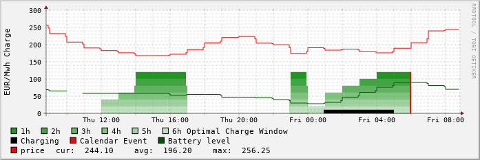

# tesla-cron

Calendar-driven Tesla charging at the cheapest prices before the next event whose title contains `[T]`.



## How it works

- Runs at minutes **1, 16, 31, 46**, evaluating 15-minute prices from the existing `el-cron` InfluxDB data.
- One charging policy at all configured locations. Location selects the price series and timezone, not a separate timetable. Price-driven charging/schedule changes happen only while stationary at those locations. The exception is the once-per-observed-drive **50% limit reset**, which also works away from them.
- Uses one-time, location-associated Tesla charging and preconditioning schedules. The car can execute them without tesla-cron staying online. Departure preconditioning is prepared when an event is within 20 hours.
- Uses a conservative six-hour full-charge estimate: 50% is the arrival baseline, 70% the normal planned target and 80% the departure target. A running 50% baseline charge is not boosted early; it can continue to the higher target when the cheapest window is already open.
- Already-running charging above 50% is left alone, including its limit and charge schedule. Only an actual future-plan update made while not charging can arm the bounded delayed-stop safety described below. No magic limits or TWC dependency are used.

## Build and offline verification

Linux, C++17, system timezone database, curl/curlpp, Boost headers and RapidJSON are required. RRD is no longer used. For Debian/Ubuntu:

```sh
sudo apt install build-essential libboost-dev libcurlpp-dev libcurl4-openssl-dev rapidjson-dev python3 tzdata openssl curl
git submodule update --init --recursive
make
make test
```

Tests use fixtures, dummy tokens and mocked transport; they do not contact Tesla or InfluxDB. When `.proxy/tesla-http-proxy` is built, optional real loopback TLS tests use throwaway keys and only its unauthenticated `/health` endpoint. Python is used for authentication/tests, not embedded in the application. `date/` and `icalendarlib/` are submodules. Do not casually run `make clean`: it also deletes the C++ source generated from the electricity-network JSON.

## Configuration

### Vehicle/account

Account, vehicles/VINs, private calendar URLs and Tesla audience are compiled from `config.local.inc` when present (Git-ignored), otherwise the tracked `config.inc` template; rebuild after changes. Keep real credentials and private URLs out of commits and logs. `TESLA_CLIENT_ID` can override the compiled client ID for token refresh. Legacy proxy URL/TLS/key-path fields in those files are retained for configuration compatibility but are no longer used by the application.

Vehicle commands use the persistent local official command proxy described below. Modern schedules require firmware 2024.26+ and a proxy supporting `add_charge_schedule` / `add_precondition_schedule`.

### Persistent local command proxy

The official [Tesla Vehicle Command SDK](https://github.com/teslamotors/vehicle-command) handles signed commands. It runs as a separate loopback-only service, not a child process of each cron run. Public app-domain/key registration and the paired Tesla command-signing key remain necessary; they are separate from local HTTPS certificates.

```sh
./scripts/build-proxy.sh
./scripts/prepare-proxy.sh /path/to/existing-paired-command-private-key.pem
sudo ./scripts/install-proxy.sh
```

If `.proxy/` is already prepared, only the last command is needed. This installs/enables **the proxy service only**, not charging cron. The build pins SDK `v0.4.1`, checks its Go checksum-database hash, and verifies the pinned Go toolchain download against official SHA-256 metadata. Go/toolchain caches stay in a private temporary build tree; Go is not installed system-wide. The tagged SDK is built as the main module because its `replace` directive prevents `go install package@version`.

- Private `.proxy/` is Git-ignored. Preparation copies the existing command key, never generates a replacement signing identity, and creates a separate ten-year self-signed local TLS certificate for `127.0.0.1`, `localhost` and `::1`. Existing key/certificate pairs are validated and preserved, not silently replaced.
- The installer puts the binary in `/usr/local/libexec/tesla-http-proxy`, credentials under `/etc/tesla-cron/proxy/`, and the unit at `/etc/systemd/system/tesla-cron-proxy.service`. Private keys are root-owned mode `0600`. A public certificate copy at `/usr/local/share/tesla-cron/proxy.crt` is readable without sudo; no private key is exposed.
- systemd `DynamicUser` plus `LoadCredential` gives the sandboxed service only its three credential files; it does not need access to Caddy storage, the user's home, or tesla-cron's OAuth token files. Requires systemd with credentials support (v247+).
- The proxy listens only on **127.0.0.1:4443**. Caddy, public DNS, public port 443, and system certificate trust are not changed. No public reverse-proxy route is needed.
- `TESLA_PROXY_URL` defaults to `https://127.0.0.1:4443`; overrides must also be HTTPS loopback URLs with no path/query/credentials. `localhost` is explicitly resolved to `127.0.0.1`. Environment HTTP proxies are disabled for local requests.
- `TESLA_PROXY_CA_FILE` defaults to `/usr/local/share/tesla-cron/proxy.crt`. Certificate-chain and hostname verification stay enabled; there is no insecure fallback. Only local proxy requests use this trust file, not Tesla's public HTTPS endpoints or system CA directories.
- The C++ client performs an unauthenticated TLS-verified `/health` check before its first command in each invocation. Failure stops before any command POST. Local health checks do not consume the Tesla request budget and work during Tesla cooldowns.

Verify after installation with `./tesla_cron --proxy-health` from your build directory, or `curl --noproxy '*' --cacert /usr/local/share/tesla-cron/proxy.crt https://127.0.0.1:4443/health`. This mode does not read OAuth tokens, require the application's state-directory ownership, or contact Tesla. To test an unprivileged staged proxy, set `TESLA_PROXY_CA_FILE` to `$PWD/.proxy/localhost.crt` and `TESLA_PROXY_URL` to its loopback URL. It does not start the proxy itself.

Use `sudo systemctl status tesla-cron-proxy` / `sudo journalctl -u tesla-cron-proxy -n 30` for service diagnostics. The installer preserves installed TLS credentials and refuses a different command key; deliberate rotation must update the matching TLS certificate/client trust together. Do not replace the Tesla signing key as a TLS renewal procedure. No client secret belongs in this service.

### Locations and electricity prices

Copy `sites.example.json` to `sites.json` (Git-ignored), then configure each site's Influx `site` tag, latitude/longitude, allowed radius in metres, and IANA timezone. A local `sites.json` prepared from `el-cron` may already be present; check its 250 m radii. The same owned schedule IDs are reused when the car moves between sites. Losing the ownership files does not authorize adoption/deletion of existing schedules.

The executable reads `/etc/tesla-cron/sites.json`, overridden by `TESLA_SITES_FILE`. Multiple matching locations use the closest centre. Configure timezones explicitly, e.g. `Europe/Copenhagen`, rather than relying on the Pi's timezone.

InfluxDB uses the same v1-compatible API/schema as `el-cron`:

- `INFLUX_URL`: default `http://localhost:8086`.
- `INFLUX_DB`: default `iot`.
- Optional `INFLUX_USER` / `INFLUX_PASS` for reads and, by default, telemetry writes. To keep the reader read-only, set separate `INFLUX_WRITE_USER` / `INFLUX_WRITE_PASS` for telemetry. Those override credentials only for writes.
- Query `el_price`, filtered by `site`, field `price`, UTC epoch seconds (`/query?epoch=s`).
- Prices are already **DKK/kWh including charges and VAT**. No second tax/tariff/conversion layer is applied. The old Energidataservice/Carnot readers and hardcoded 2023 charges are no longer used.
- Requires genuine 15-minute slots. Missing/null prices are gaps, not free electricity; hourly rows are not silently expanded and future prices are not invented. If no complete priced window fits before departure, existing schedules are left unchanged.

Read-only price verification (no Tesla requests):

```sh
TESLA_SITES_FILE="$PWD/sites.json" ./tesla_cron --prices-only
```

`--dry-run` evaluates calendars/prices using an existing valid vehicle cache only; it never contacts Tesla or sends commands. It fails if a usable cache is absent. Neither mode is a live vehicle smoke test.

To bootstrap/validate the new vehicle schema, `--snapshot` makes **one vehicle-data request per configured car**, saves a validated cache, and exits. It sends no wake or charging commands and starts no proxy. Run it only when the vehicle is already awake; there are no retries if it is asleep. It may first refresh an expired access token. Then use `--dry-run` to review whether changes would be needed before enabling normal operation.

### Authentication

```sh
cp auth.env.example .auth.env
chmod 600 .auth.env
# Edit client ID, client secret and exact Tesla-registered callback URI locally.
./auth.sh
```

Open the printed link, authorize, then paste the **full callback URL**, including `code` and `state`, into the terminal. The callback page itself need not load. Do not share the callback URL or tokens. Credentials may instead come from environment variables or a trusted shell config selected by `TESLA_AUTH_CONFIG`.

Location-based operation needs the `vehicle_location` scope in addition to vehicle data/charging permissions. If the previous authorization did not include it, enable it for the Tesla developer app and rerun authorization; refreshing alone does not request new consent.

Tokens are owner-only (`0600`) under `/var/tmp/tesla-cron`; the directory must be a private non-symlink directory with mode `0700`, owned by the running user (including when running as root). Run authorization and the application as the same user (root for the installed cron job). `TOKEN_DIR` is an auth-script-only override for isolated testing. Failed HTTP exchanges and invalid responses do not overwrite existing tokens.

The application reuses access tokens until within five minutes of JWT expiry. Unknown/opaque token formats are refreshed rather than assumed valid. To force exactly one refresh without proxy/vehicle activity:

```sh
./tesla_cron --refresh-token
```

The executable does not load `.auth.env`; supply the client ID through `config.inc` or `TESLA_CLIENT_ID`. Do not run forced refresh repeatedly or concurrently with authorization. Older builds created the token directory with mode `0600`; repair that directory to `0700`, not the token files.

## Rate limits and schedule safety

- All Tesla HTTP requests are single-attempt, including commands and timeouts. Wake-up sends one wake command followed by at most four status checks; it does not resend wake-up.
- Maximum 20 Tesla requests per invocation. An exclusive run lock prevents overlapping local invocations; this does not account for other Tesla applications using the account.
- HTTP 429 saves a cross-run cooldown, honoring `Retry-After` / `RateLimit-Reset` with a conservative 15-minute minimum. An unreadable/corrupt cooldown stops requests, not bypasses the limit.
- Every normal run checks online status. If online, one fresh vehicle snapshot detects driving/arrival even when the parked cache is recent; there is no one-hour blind spot. Sleeping cars use cached planning and are woken only for an observed-drive arrival check, baseline-charge completion, bootstrap, or a needed plan change. Drives entirely between 15-minute observations can still be missed; that accepted tradeoff avoids a new TWC/event dependency.
- The 50% driving reset is independent of location, prices and calendars. It happens once per observed drive (disconnected with nonzero speed or a drive gear); a later manual limit selection during that drive is not repeatedly overwritten. Known local quota/cooldown or proxy-health failures do not consume the reset. An attempted but ambiguously acknowledged reset is latched, not blindly replayed.
- While a baseline charge is running, later target increases wait unless charging is already optimal now. If it stops below 50% with its baseline limit, the controller can start it to reach that minimum. Once the baseline finishes, a pending-completion observation allows the future schedule/target to be prepared even if the car has since slept. Parked disconnected cars do not have their manually selected limit reset.
- Unchanged schedules and charge limits generate no commands. Charge/preconditioning data are fetched together in the same vehicle-data request.
- `/var/tmp/tesla-cron/schedules-<VIN>.json` records owned IDs **before** posting. Updates reuse those IDs, including after ambiguous timeouts. Only recorded IDs can be removed; manual schedules and untracked schedules left by older versions are preserved. Review old duplicates manually before the first deployment.
- Keep the ownership files when moving installations. Do not delete them as a reset procedure.
- Schedules select the actual local weekday and `one_time: true`, not daily recurrence. The API cannot distinguish the two occurrences of an ambiguous DST clock time; those schedule times are rejected rather than guessed.

### Single delayed charging safety check

When a real future charging-schedule/limit change is made while the car was **not already charging**, had reached 50%, and the intended start is more than three minutes away, the controller can remain running for a single two-minute check (plus a one-minute start-time safety margin):

1. Persist the guard before the relevant write, and install/update the future schedule before raising its limit.
2. After two minutes, consume the guard durably, then take **one fresh full snapshot**.
3. Send at most one `charge_stop` only if the car is now Charging/Starting, remains at the same configured site, is not moving, still has the expected limit and unchanged owned native schedule, and its intended start is still more than a minute away. The margin avoids racing a legitimate scheduled start with a slow stop command.

If the car is already waiting, unplugged, at a changed limit/site/schedule, or the read fails, there is no stop. An intentional immediate start, unchanged plan, or preconditioning-only update never arms this guard. It expires after five minutes, with stops disabled within a minute of the scheduled start; stops and failed checks are never repeated. A pending guard after a process restart completes as a standalone operation, without a new plan being applied in that invocation. It takes its single read even if a summary would say asleep, but does not issue a wake or retry solely for the check.

This adds at most one read plus one stop per guarded update, with space reserved in the 20-request budget (including a possible token refresh). There is no continuous monitoring. State is private `/var/tmp/tesla-cron/control-<VIN>.json`; preserve it alongside schedule ownership files. A manual Start during this short correction window can be stopped once; afterward starting again does not require changing the charge limit.

The controller itself sends no schedule-removal command as part of that corrective stop. **Verify on the car that its native timer starts charging later after a forced stop before enabling unattended operation.** Offline tests verify command ordering and guards, not firmware behavior.

### One-time cleanup of legacy preconditioning schedules

Normal runs deliberately leave untracked schedules alone. For a separately reviewed legacy list, `scripts/cleanup_preconditioning.py` freezes the cached IDs and schedule details into an immutable private manifest before any API activity:

```sh
python3 -B scripts/cleanup_preconditioning.py --prepare-from-cache PATH_TO_REVIEWED_CACHE \
  --manifest /var/tmp/tesla-cron/legacy-preconditioning.json --expected-count 62
python3 -B scripts/cleanup_preconditioning.py \
  --manifest /var/tmp/tesla-cron/legacy-preconditioning.json --expected-count 62
# Only after reviewing/approving that exact scope:
python3 -B scripts/cleanup_preconditioning.py \
  --manifest /var/tmp/tesla-cron/legacy-preconditioning.json --expected-count 62 --execute
```

- Preparation requires the exact approved count of enabled, recurring schedules. Execution deletes only approved IDs still present in a fresh read, and rejects entries whose stored details already changed (apart from negligible coordinate decoder round-off). Newly added IDs are preserved. Do not edit the approved IDs through another client during cleanup; Tesla has no conditional compare-and-delete operation.
- It holds the controller run lock for the whole operation, spaces every Tesla-bound request by at least four seconds, and durably saves progress before requests. Local unauthenticated `/health` is quota-exempt. HTTP 429 saves the shared cooldown and stops; timeouts/ambiguous responses are never blindly retried.
- The optional `--allow-wake` permits at most one wake per manifest, only after the first read returns HTTP 408. Otherwise an asleep vehicle stops cleanup. There are no charge-start, charge-stop, charge-limit, or charging-schedule removal calls.
- Keep the manifest, its `.progress` journal and private `.progress.snapshot` diagnostic record, with the same owner as the state directory. If interrupted, rerun the same manifest: it rechecks current state before any further removals. Refresh an expired access token separately; cleanup never rotates tokens or repeats a possibly successful command blindly.
- Completion requires another fresh schedule read. This does not rewrite the old vehicle cache; refresh that separately when needed. This maintenance command is explicitly independent of charging-location geofences and **must not be installed in cron**. Normal operation thereafter uses the two recorded schedule IDs per vehicle, rather than accumulating new IDs.

## Install

Review configuration and read-only checks before enabling live charging. `sudo make install` first requires the proxy's TLS health check to pass, then installs the executable/runner, sets the state directory's owner to root with mode `0700`, and **overwrites `/etc/cron.d/tesla_cron`** with the quarter-hour root job. The controller executable is owner-only (`0700`) because it embeds private configuration, including calendar URLs; the installed copy runs as root. It copies local `sites.json` only when the installed configuration does not already exist; it does not overwrite an existing site configuration. After installation, use root for live state/auth operations; isolated offline tests still run unprivileged.

Optional runtime environment is read from `/etc/tesla-cron/runtime.env` by `/usr/local/bin/tesla-cron-run`; use `runtime.env.example` as a template, owned by root with mode `0600`. Do not put the OAuth client secret there. Cron output goes to `/var/log/tesla_cron.log`.

## Influx telemetry and graphs

Normal controller runs write one line-protocol observation to **`tesla_cron`**, tagged by **`site`** and **`vin`**, using the same Influx URL/database as prices. It is separate from `el_price` and the existing Wall Connector `twc` measurement. There are no extra Tesla reads for telemetry. Cached, unchanged plans still produce observations; read-only modes (`--snapshot`, `--dry-run`, `--prices-only`, `--proxy-health`) do not write telemetry.

| Field | Type / meaning |
|---|---|
| `price_dkk_kwh` | Float, price including charges/VAT; `price_slot_start` is its UTC slot-start epoch second |
| `battery_level`, `charge_limit` | Integer percent |
| `charge_window_level` | Integer 0–6: 0 = no current cheap window; 1 = six-hour window through 6 = one-hour window |
| `charging`, `event`, `cached` | Booleans; event means the planning deadline is in the next 15 minutes; cached explicitly marks reused state |
| `next_event` | Integer UTC epoch second of the next planning deadline (calendar event or lookahead cap) |
| `vehicle_data_time`, `snapshot_age_s` | Original vehicle snapshot time and age; omitted if unknown, with `cached=true` |

Point timestamps are **current UTC observation times**, written with `precision=s`, never a future price/event time. Server retention policy applies; no retention policies or databases are created/changed. Write failures are logged without response bodies, do not retry, and do not fail or replay successful charging commands. Default timeouts are 10 seconds for queries and 2 seconds for writes; `INFLUX_TIMEOUT_MS` overrides either (1–60000).

Example dashboard query:

```sql
SELECT "battery_level", "charge_limit", "price_dkk_kwh", "charging", "cached", "snapshot_age_s"
FROM "tesla_cron"
WHERE "vin" = 'YOUR_VIN' AND time > now() - 7d
ORDER BY time ASC
```

The standalone SVG helper now reads **InfluxDB**, not `.rrd` files, and uses only Python's standard library:

```sh
./graph.sh                       # discover VIN tags and render day/week SVGs
./graph.sh --vin YOUR_VIN         # only this vehicle
```

Outputs default to private `/var/tmp/tesla-cron-graphs/tesla-<VIN>-{d,w}.svg` files. Both periods share one week query per vehicle. Price bars use the original 15-minute slot boundaries; battery lines are dashed for cached/unknown readings, and missing periods are not interpolated. Times are labeled UTC. An empty measurement produces a clean "no telemetry yet" message.

For intentional web publication, use `--output-dir /your/web/directory --public` and configure web-server access controls first. This makes SVGs mode `0644`; otherwise they are `0600`. The output directory must be owned by the writer, and existing directory permissions are never weakened automatically. `doc/web_example.html` is a static example suitable for Caddy; no CGI or Caddy changes are required by this project.

Existing RRD history is **not deleted or automatically imported**. The archived example image is retained for reference. Docker support remains incomplete.
